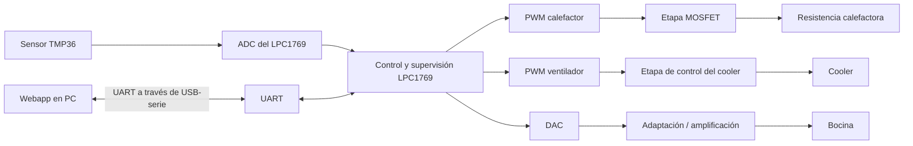

# Sistema de Control de Temperatura para una Incubadora Neonatal a Escala

> **Asignatura:** Electrónica Digital III — Universidad Nacional de Córdoba  
> **Integrantes:** Urquiza Maximo, Ryan Andres
> **Profesor:** Marcos Blasco
> **Estado del proyecto:** En desarrollo

---

## 1. Descripción General del Proyecto

Se desarrollará un **prototipo a escala de una incubadora neonatal con control automático de temperatura**, utilizando un microcontrolador **LPC1769**. El sistema medirá la temperatura interna mediante un sensor **TMP36** y la comparará con una **temperatura de referencia configurada desde una aplicación web en una PC**.

A partir del error entre la temperatura medida y la de referencia, el microcontrolador regulará la potencia de una **resistencia calefactora de bajo voltaje** y la velocidad de un **ventilador (cooler)** mediante señales **PWM**. Además, incorporará una **alarma sonora generada por el DAC** y reproducida mediante una bocina de baja potencia cuando la temperatura supere los límites definidos para la demostración. La comunicación entre la placa y la interfaz será **bidireccional por UART**.

### Alcances del Proyecto 

**El sistema SÍ contempla:**

- Medir la temperatura del interior de la maqueta con un TMP36 y adquirir su señal mediante el ADC del LPC1769.
- Permitir configurar la temperatura de referencia desde una **webapp** ejecutada en la PC.
- Transmitir periódicamente la temperatura medida y el estado de los actuadores desde la placa hacia la PC por UART.
- Enviar órdenes y una consigna de temperatura desde la PC hacia la placa por la misma conexión UART.
- Regular el calefactor y el cooler mediante PWM, de acuerdo con el error de temperatura.
- Generar una señal de alarma mediante el DAC cuando se detecte una temperatura fuera de los límites de prueba.
- Visualizar la medición, la consigna, el estado de los actuadores y las alarmas en la interfaz.

**El sistema NO contempla:**

- Uso clínico, certificación sanitaria ni cumplimiento de normas de seguridad de incubadoras reales.
- Control de humedad, concentración de oxígeno ni otras variables fisiológicas.
- Monitoreo de signos vitales del paciente.
- Alimentación autónoma mediante batería, registro persistente de datos o conectividad inalámbrica (salvo futuras ampliaciones).

---

## 2. Arquitectura del Sistema: Hardware y Software

### Hardware e Interconexión

**Componentes principales:**

| Componente | Función dentro del sistema |
|---|---|
| **LPC1769** | Adquisición, procesamiento, control y comunicaciones. |
| **TMP36** | Medición analógica de temperatura (sensibilidad nominal de 10 mV/°C). |
| **Resistencia calefactora de bajo voltaje** | Actuador encargado de aumentar la temperatura de la maqueta. |
| **Cooler PWM** | Circulación de aire y, si existe ventilación/intercambio térmico adecuado, asistencia al enfriamiento. |
| **Transistores MOSFET** | Etapas de conmutación/potencia para las cargas, según el circuito definitivo. |
| **Bocina de baja potencia** | Reproducción de la señal acústica generada mediante el DAC y una etapa de adaptación/amplificación. |
| **Enlace UART–USB** | Comunicación serie entre el microcontrolador y la PC. |
| **PC con webapp** | Interfaz para visualizar mediciones, configurar la referencia y enviar comandos. |

**Diagrama de bloques propuesto:**



**Esquemático del circuito:** Pendiente de incorporar en `hardware/` una vez finalizado el diseño.

### Descripción del Circuito y Consideraciones de Diseño

1. **Adquisición:** El TMP36 entrega una tensión proporcional a la temperatura, que se acondicionará, si es necesario, para garantizar que la entrada analógica del LPC1769 permanezca dentro de su rango permitido. El ADC convertirá esa tensión en un valor digital que se expresará en °C.
2. **Calefacción:** Una salida PWM controlará un **MOSFET de canal N de nivel lógico**, dimensionado para conducir adecuadamente con el nivel de control disponible (3,3 V), que regulará la potencia media entregada a la resistencia de bajo voltaje.
3. **Ventilación:** El cooler se regulará mediante PWM. Al ser de dos cables podrá controlarse mediante una etapa de potencia PWM apropiada.
4. **Alarma:** El DAC generará una señal de audio que se aplicará a la bocina **a través de un amplificador**, dado que la salida del DAC no debe alimentar directamente la carga de un parlante.

### Arquitectura de Software (Firmware)

---

## 3. Especificaciones Eléctricas, Alimentación y Entorno

### Parámetros de Alimentación y Consumo

| Parámetro | Especificación prevista |
|---|---|
| Lógica del LPC1769 | 3,3 V según las especificaciones de la placa y sus periféricos. |
| Sensor TMP36 | Alimentación a definir según el modelo y el diseño de acondicionamiento. |
| Resistencia calefactora | Baja tensión; valor nominal de tensión, potencia y corriente: **pendiente de selección**. |
| Cooler | Tensión y corriente nominales: **pendientes de confirmar**. |
| Bocina y amplificador | Baja potencia; tensión y consumo: **pendientes de definir**. |
| Fuente de potencia | Externa, dimensionada para la suma de las cargas y sus corrientes máximas. |
| Consumo total estimado / medido | **Pendiente de cálculo y medición experimental**. |

### Microcontrolador y Herramientas

- **Microcontrolador principal:** NXP LPC1769 (ARM Cortex-M3).
- **Entorno de desarrollo:** MCUXpresso IDE.
- **Lenguaje:** C.
- **Periféricos del microcontrolador:**
  - **ADC:** digitalización de la señal del TMP36.
  - **UART:** enlace serie bidireccional con la PC.
  - **PWM / temporizadores:** control de la resistencia y del cooler.
  - **DMA y DAC:** generación de la señal de alarma.
  - **Interrupciones y temporización:** adquisición, actualización de salidas y procesamiento de eventos.

### Interfaz de Usuario (Webapp)

La webapp tendrá, como mínimo, los siguientes elementos:

- Visualización de **temperatura actual**, **temperatura de referencia** y **estado de conexión**.
- Entrada para elegir y enviar una nueva consigna.
- Indicadores del porcentaje PWM aplicado al calefactor y al cooler.
- Aviso visible ante una alarma o falla del sensor.
- Controles para iniciar/detener la regulación y solicitar el estado actual.

**Conexión:** la webapp podrá utilizar la **Web Serial API** cuando se ejecute en un navegador compatible (por ejemplo, Chrome o Edge, en un contexto permitido como `localhost` o HTTPS) y la placa disponga de un puerto serie accesible mediante USB–UART. Si se elige otro navegador, podrá implementarse un puente local entre UART y la webapp. No se enviarán directamente niveles eléctricos RS-232 al LPC1769: se utilizará un adaptador con niveles compatibles.

---

## 4. Proceso de Integración y Desarrollo

El desarrollo se dividirá en etapas para comprobar cada subsistema antes de integrarlo:

1. **Etapa 1 — Validación inicial:** configurar el reloj del LPC1769, GPIO, temporizadores y entorno de depuración; verificar el funcionamiento básico de la placa.
2. **Etapa 2 — Sensor y adquisición:** conectar el TMP36, validar niveles de tensión, calibrar la lectura del ADC y contrastar mediciones con un termómetro de referencia.
3. **Etapa 3 — Comunicación e interfaz:** establecer UART bidireccional, implementar el protocolo documentado en la sección 7 y conectar la webapp.
4. **Etapa 4 — Actuadores:** implementar y medir las salidas PWM, integrar los MOSFET y verificar la activación del calefactor y el cooler de forma independiente.
5. **Etapa 5 — Alarmas y control:** generar la señal del DAC, implementar las condiciones de alarma y cerrar el lazo térmico con una estrategia de control ajustable.
6. **Etapa 6 — Integración y validación:** ejecutar los criterios de aceptación de la sección 5, registrar resultados y adjuntar fotografías y capturas del montaje final.

---

## 5. Ensayos, Pruebas y Resultados

### Criterios de Aceptación del Prototipo

**Parámetros propuestos para el prototipo:**

- Consigna configurable: **34,0–37,0 °C**.
- Umbral inferior de alarma de demostración: **32,0 °C**.
- Umbral superior de alarma de demostración: **38,0 °C**.
- Período de telemetría: **1 segundo**.
- Banda muerta, ganancia de control, frecuencia de PWM y política de reconexión: **a ajustar/documentar durante el desarrollo**.

### Registro de Pruebas y Resultados

| Ensayo | Resultado medido | Estado | Evidencia |
|---|---|---|---|
| Temperatura y ADC | Pendiente | Sin ensayar | [Agregar archivo o captura] |
| UART bidireccional | Pendiente | Sin ensayar | [Agregar registro serie] |
| PWM calefactor y ventilador | Pendiente | Sin ensayar | [Agregar medición de instrumental] |
| Control de temperatura | Pendiente | Sin ensayar | [Agregar gráfico] |
| DAC y alarma sonora | Pendiente | Sin ensayar | [Agregar evidencia] |
| Webapp e integración | Pendiente | Sin ensayar | [Agregar captura y foto] |

**Evidencia obligatoria a incorporar:** fotografía del prototipo completo; captura de la webapp; registro de tramas UART; mediciones del ADC y las salidas PWM; gráfico de temperatura vs. tiempo; evidencia de la alarma por DAC.

---

## 6. Estructura del Repositorio

Estructura propuesta para organizar el firmware, la webapp y la documentación:

```text
├── firmware/
│   ├── src/              # Implementación en C para el LPC1769
│   └── inc/              # Archivos de cabecera
├── webapp/                # Interfaz de usuario y comunicación serie desde PC
├── hardware/              # Esquemáticos, lista de materiales y montaje
├── docs/                  # Diagramas, notas técnicas y capturas de pruebas
├── tests/                 # Registros y datos de validación
├── .gitignore             # Exclusiones del IDE y archivos generados
└── README.md              # Documentación principal del proyecto
```

Se excluirán mediante `.gitignore` las carpetas generadas por el entorno de compilación y depuración (por ejemplo `Debug/` y `Release/`), además de archivos temporales.

---

## 7. Protocolo de Comunicación UART

El enlace serie será **bidireccional** entre la PC y el LPC1769. La webapp enviará consignas y comandos, mientras que el microcontrolador transmitirá las mediciones, los estados y las alarmas.

### Configuración Inicial Propuesta

| Parámetro | Valor |
|---|---|
| Medio físico | UART TTL compatible con la placa, mediante puente USB–UART hacia la PC |
| Baud rate | **115200 bit/s** |
| Bits de datos | **8** |
| Paridad | **Ninguna** |
| Bits de stop | **1** |
| Control de flujo | **Ninguno** |
| Codificación | Texto **ASCII** |
| Delimitación de trama | Salto de línea `\n` |
| Separador de campos | Coma `,` |
| Separador decimal | Punto `.` |

> La configuración UART y el formato aquí descritos son la **propuesta de implementación**. Si se cambia alguno, se debe actualizar esta sección y mantener sincronizados el firmware y la webapp.

### Comandos desde la PC hacia el Microcontrolador

| Trama | Función | Ejemplo |
|---|---|---|
| `SET,TREF,<valor>\n` | Establecer temperatura de referencia en °C. | `SET,TREF,36.5\n` |
| `CMD,START\n` | Iniciar la regulación. | `CMD,START\n` |
| `CMD,STOP\n` | Detener la regulación y apagar el calefactor. | `CMD,STOP\n` |
| `CMD,STATUS\n` | Solicitar el estado actual. | `CMD,STATUS\n` |

### Mensajes desde el Microcontrolador hacia la PC

| Trama | Función | Ejemplo |
|---|---|---|
| `DATA,<T>,<TREF>,<H>,<F>,<A>\n` | Telemetría periódica. | `DATA,36.2,36.5,35,20,0\n` |
| `ACK,TREF,<valor>\n` | Confirma una consigna válida. | `ACK,TREF,36.5\n` |
| `ACK,<comando>\n` | Confirma la ejecución de un comando. | `ACK,START\n` |
| `ALARM,<tipo>,<T>\n` | Notifica alarma de temperatura o falla. | `ALARM,HIGH,38.2\n` |
| `ERR,<codigo>\n` | Rechaza una trama o un parámetro inválido. | `ERR,OUT_OF_RANGE\n` |

**Campos de `DATA`:**

- `T`: temperatura medida en °C.
- `TREF`: temperatura de referencia en °C.
- `H`: ciclo de trabajo del calefactor, en porcentaje (`0–100`).
- `F`: ciclo de trabajo del ventilador, en porcentaje (`0–100`).
- `A`: indicador de alarma (`0` = sin alarma; `1` = alarma activa).

**Tipos de alarma propuestos:** `LOW`, `HIGH`, `SENSOR_FAIL`.  
**Códigos de error propuestos:** `BAD_FORMAT`, `UNKNOWN_CMD`, `OUT_OF_RANGE`.

### Ejemplo de Intercambio

```text
PC  -> LPC1769: SET,TREF,36.5
MCU -> PC:      ACK,TREF,36.5
PC  -> LPC1769: CMD,START
MCU -> PC:      ACK,START
MCU -> PC:      DATA,35.8,36.5,70,20,0
MCU -> PC:      DATA,36.2,36.5,35,20,0
MCU -> PC:      DATA,38.2,36.5,0,100,1
MCU -> PC:      ALARM,HIGH,38.2
PC  -> LPC1769: CMD,STOP
MCU -> PC:      ACK,STOP
```

**Validaciones de protocolo:** se rechazarán valores no numéricos, referencias fuera de rango y comandos desconocidos. Una nueva consigna solo se aplicará luego de validarse. Las tramas deberán procesarse sin bloquear el lazo de control. El tratamiento de tramas incompletas y cortes de conexión se documentará al completar la implementación.

---

## 8. Cumplimiento de los Requisitos del Trabajo Práctico

| Requisito solicitado | Implementación prevista | Verificación |
|---|---|---|
| **Comunicación con PC bidireccional para controlar el microcontrolador** | UART: la PC envía consigna y comandos; el LPC1769 responde y transmite datos del proceso. | CA-02, CA-03, CA-04 y CA-11. |
| **Interfaz de usuario** | Webapp con visualización de temperatura, consigna, estados de funcionamiento, PWM y alarmas. | CA-12. |
| **Protocolo de comunicación documentado en el README** | Sección 7: configuración del enlace, formato de tramas, campos, comandos, respuestas y ejemplos. | CA-02, CA-03 y CA-04. |
| **Un sensor de los vistos en clase** | TMP36, sensor analógico de temperatura conectado a una entrada ADC del LPC1769. | CA-01 y CA-10. |
| **Un actuador de los vistos en clase** | Resistencia calefactora y cooler controlados por PWM a través de sus respectivas etapas de potencia/control; además, bocina activada desde el DAC. | CA-05, CA-06 y CA-09. |
| **Definir criterios de aceptación completos según el TP individual** | Sección 5: criterios cuantificables de medición, comunicaciones, interfaz, PWM, regulación, alarmas y fallas. | CA-01 a CA-12 y evidencias experimentales. |

**Estado de cumplimiento:** los requisitos se encuentran **cubiertos en el diseño propuesto**. Su cumplimiento efectivo se confirmará únicamente después de implementar, ensayar y registrar la evidencia correspondiente.

---

## 9. Referencia del Formato

La organización general de este README toma como referencia la plantilla de trabajo final de Electrónica Digital II/III: [MarcosUNC/TPfinalDIGII-III](https://github.com/MarcosUNC/TPfinalDIGII-III).
