# Sistema de Control de Temperatura para una Incubadora Neonatal a Escala

> **Asignatura:** Electrónica Digital III — Universidad Nacional de Córdoba  
> **Integrantes:** Urquiza Maximo, Ryan Andres
> **Profesor:** Marcos Blasco
> **Estado del proyecto:** En desarrollo

---

## 1. Descripción General del Proyecto

Se desarrollará un **prototipo a escala de una incubadora neonatal con control automático de temperatura**, utilizando un microcontrolador **LPC1769**. El sistema medirá la temperatura interna mediante un sensor **TMP36** y la comparará con una **temperatura de referencia configurada desde una aplicación web en una PC**.

A partir del error entre la temperatura medida y la de referencia, el microcontrolador regulará la potencia de una **resistencia calefactora de bajo voltaje** y la velocidad de un **ventilador (cooler)** mediante señales **PWM**. Además, incorporará una **alarma sonora generada por el DAC** y reproducida mediante una bocina de baja potencia cuando la temperatura supere los límites definidos para la demostración. La comunicación entre la placa y la interfaz será **bidireccional mediante UART y un módulo Bluetooth HC-05**, que enlaza el LPC1769 con la PC.

### Alcances del Proyecto 

**El sistema SÍ contempla:**

- Medir la temperatura del interior de la maqueta con un TMP36 y adquirir su señal mediante el ADC del LPC1769.
- Permitir configurar la temperatura de referencia desde una **webapp** ejecutada en la PC.
- Transmitir periódicamente la temperatura medida y el estado de los actuadores desde la placa hacia la PC por UART.
- Enviar órdenes y una consigna de temperatura desde la PC hacia la placa por la misma conexión UART.
- Regular el calefactor y el cooler mediante PWM, de acuerdo con el error de temperatura.
- Generar una señal de alarma mediante el DAC cuando se detecte una temperatura fuera de los límites de prueba.
- Visualizar la medición, la consigna, el estado de los actuadores y las alarmas en la interfaz.

**El sistema NO contempla:**

- Uso clínico, certificación sanitaria ni cumplimiento de normas de seguridad de incubadoras reales.
- Control de humedad, concentración de oxígeno ni otras variables fisiológicas.
- Monitoreo de signos vitales del paciente.
- Alimentación autónoma mediante batería ni registro persistente de datos.

---

## 2. Arquitectura del Sistema: Hardware y Software

### Hardware e Interconexión

**Componentes principales:**

| Componente | Función dentro del sistema |
|---|---|
| **LPC1769** | Adquisición, procesamiento, control y comunicaciones. |
| **TMP36** | Medición analógica de temperatura (sensibilidad nominal de 10 mV/°C). |
| **Resistencia calefactora de bajo voltaje** | Actuador encargado de aumentar la temperatura de la maqueta. |
| **Cooler PWM** | Circulación de aire y, si existe ventilación/intercambio térmico adecuado, asistencia al enfriamiento. |
| **Transistores MOSFET** | Etapas de conmutación/potencia para las cargas, según el circuito definitivo. |
| **Bocina de baja potencia** | Reproducción de la señal acústica generada mediante el DAC y una etapa de adaptación/amplificación. |
| **Módulo Bluetooth HC-05** | Puente entre la UART del LPC1769 y el enlace Bluetooth serie con la PC. |
| **PC con webapp** | Interfaz para visualizar mediciones, configurar la referencia y enviar comandos. |

#### Diagrama de bloques

El diagrama muestra el flujo de medición, el envío de consignas desde la PC y las salidas hacia las resistencias, el cooler y la alarma térmica.

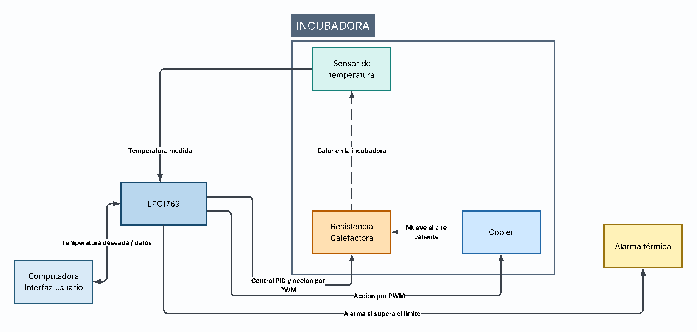

[Abrir diagrama de bloques en PDF](hardware/diagramas/diagrama-bloques.pdf).

### Esquemático general

El circuito completo reúne las conexiones del LPC1769 con el TMP36, las etapas PWM, el amplificador LM386 y el módulo HC-05, junto con las líneas de alimentación y masa común. Los subsistemas se detallan a continuación.

<details>
<summary>Ver el circuito completo</summary>

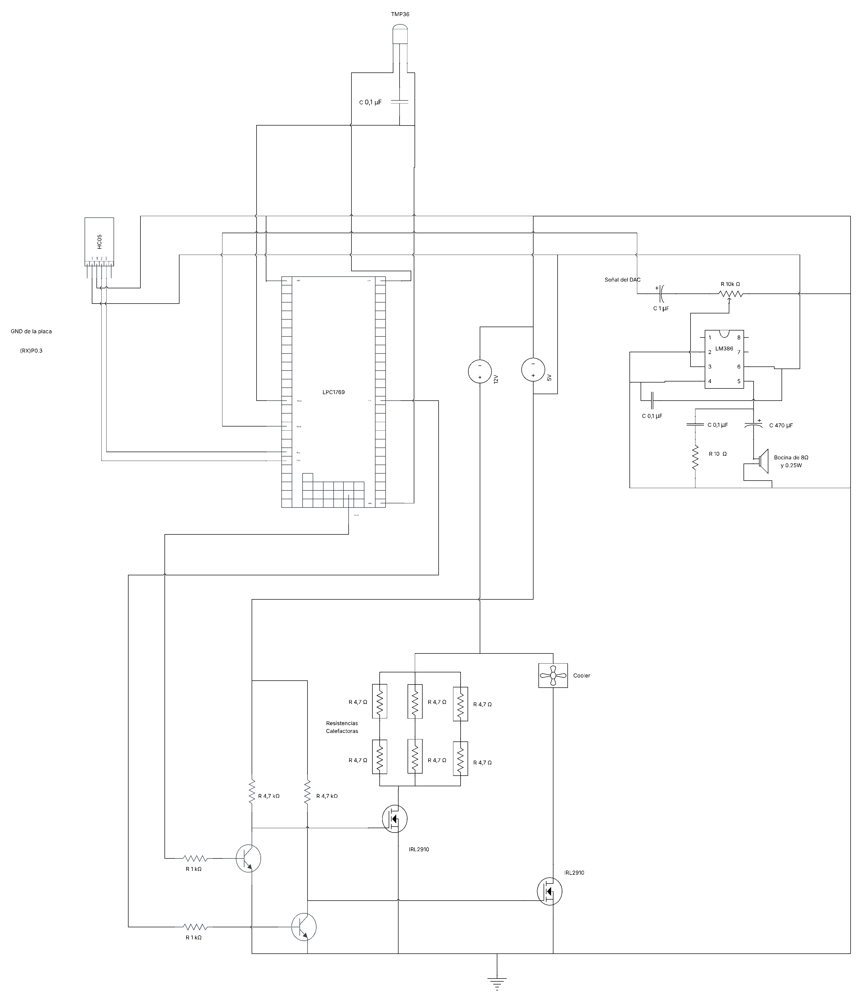

</details>

[Abrir circuito completo en PDF para consultar los detalles](hardware/diagramas/circuito-completo.pdf).

### Descripción del Circuito y Consideraciones de Diseño

#### Sensor TMP36 y adquisición por ADC

El TMP36 entrega una tensión proporcional a la temperatura. Su salida se conecta a **P0.23 / AD0.0** del LPC1769 para digitalizar la medición. El esquema incluye la alimentación de 3,3 V, la masa de la placa y un capacitor de 0,1 µF.

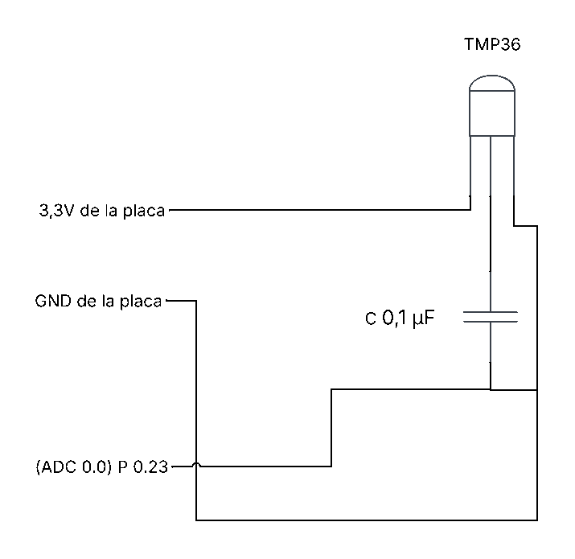

[Abrir circuito del sensor en PDF](hardware/diagramas/sensor-tmp36.pdf).

#### Etapas de potencia y control PWM

Las salidas PWM gobiernan las etapas de conmutación de las resistencias calefactoras y del cooler. El diagrama reúne ambas cargas, los MOSFET IRL2910 y los transistores de excitación, con sus resistencias y las alimentaciones de 5 V y 12 V. Las conexiones al microcontrolador se identifican en el esquemático general.

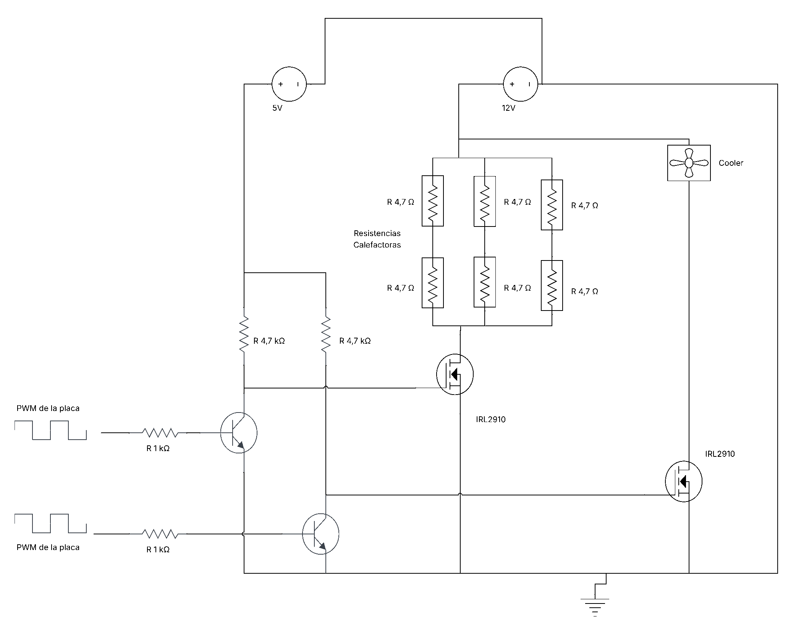

[Abrir circuito PWM en PDF](hardware/diagramas/circuito-pwm.pdf).

#### Salida de audio y amplificador LM386

La señal del DAC del LPC1769 se aplica al **LM386**, que amplifica el audio para una bocina de 8 Ω y 0,25 W. El esquema incluye el ajuste de nivel de entrada, el acoplamiento de salida y los componentes de desacoplamiento de la etapa alimentada a 5 V.

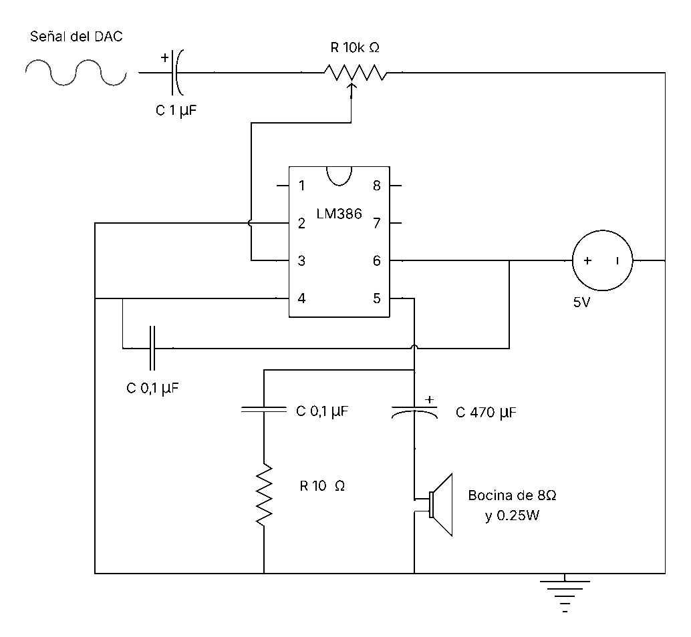

[Abrir circuito del LM386 en PDF](hardware/diagramas/amplificador-lm386.pdf).

#### Comunicación UART con la PC mediante HC-05

El **HC-05** enlaza la UART0 del LPC1769 con la PC mediante Bluetooth Classic y el perfil serie SPP. En el montaje se conecta **P0.2 / TXD0 al RXD del HC-05** y **P0.3 / RXD0 al TXD del HC-05**, compartiendo masa. La UART se configura a **9600 baudios, 8 bits de datos, sin paridad y un bit de parada (8N1)**, sin control de flujo.

El esquema representa la alimentación de 5 V de la placa adaptadora del HC-05 y su conexión a la masa de la placa del microcontrolador.

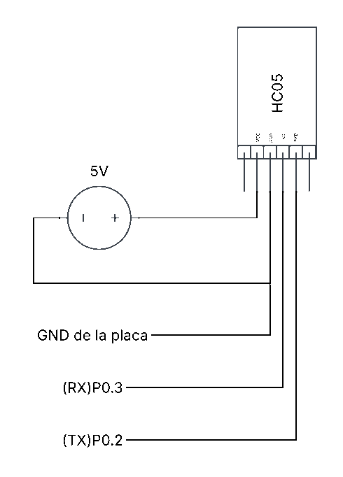

[Abrir conexión UART con HC-05 en PDF](hardware/diagramas/conexion-uart-hc05.pdf).

### Arquitectura de Software (Firmware)

El firmware está desarrollado en C y utiliza los drivers de la biblioteca `CMSISv2p00_LPC17xx`. Su ejecución se organiza mediante un bucle principal coordinado por SysTick, con un período de muestreo de **100 ms**.

#### Organización por módulos

| Módulo | Responsabilidad |
|---|---|
| `main` | Inicializa el sistema, coordina las mediciones, recibe consignas por UART y supervisa el control y la alarma. |
| `temperature_sensor` | Configura el ADC, adquiere la señal del TMP36 y convierte el resultado a temperatura. |
| `temperature_filter` | Aplica una mediana de tres muestras y un filtro IIR para reducir picos y fluctuaciones. |
| `temperature_controller` | Calcula el duty de las resistencias mediante precalentamiento y regulación PI/PID configurable, con compensación de mantenimiento y protección contra acumulación de la integral. |
| `actuators_pwm` | Genera las señales de control de las resistencias y del cooler, compensando la polaridad de las etapas de potencia. |
| `speaker_sine` | Genera el tono de alarma mediante una tabla de muestras en RAM, transferida al DAC por DMA. |

#### Ciclo de procesamiento

En cada período, el programa consulta los datos recibidos desde la PC, valida las consignas y realiza una adquisición del sensor. Las mediciones válidas se filtran y se utilizan para actualizar la potencia de calefacción y evaluar la alarma térmica.

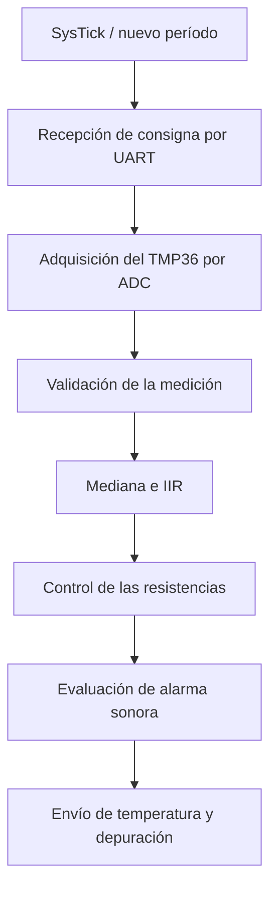

La calefacción espera una consigna válida antes de comenzar. El controlador modifica únicamente el duty de las resistencias; el cooler mantiene un porcentaje fijo configurable, actualmente **15 %**.

#### Temporización, supervisión y depuración

SysTick establece la base temporal y permite cortar la calefacción si transcurre un segundo sin una medición válida durante la regulación. Timer1 genera la señal de las resistencias y PWM1 controla el cooler. El DMA mantiene la reproducción del tono mientras la alarma está activa.

El firmware supervisa los tiempos de adquisición, las lecturas fuera de rango y la sobretemperatura. El modo de prototipo contempla recuperación automática ante fallos transitorios y enclavamiento ante sobretemperatura confirmada.

Las mediciones filtradas se transmiten por UART al HC-05. La salida por semihosting permite observar además la consigna, el duty aplicado, el estado del controlador y los contadores de diagnóstico.

---

## 3. Especificaciones Eléctricas, Alimentación y Entorno

### Parámetros de Alimentación y Consumo

| Parámetro | Especificación prevista |
|---|---|
| Lógica del LPC1769 | 3,3 V según las especificaciones de la placa y sus periféricos. |
| Sensor TMP36 | Alimentación a definir según el modelo y el diseño de acondicionamiento. |
| Resistencia calefactora | Baja tensión; valor nominal de tensión, potencia y corriente: **pendiente de selección**. |
| Cooler | Tensión y corriente nominales: **pendientes de confirmar**. |
| Bocina y amplificador | Baja potencia; tensión y consumo: **pendientes de definir**. |
| Fuente de potencia | Externa, dimensionada para la suma de las cargas y sus corrientes máximas. |
| Consumo total estimado / medido | **Pendiente de cálculo y medición experimental**. |

### Microcontrolador y Herramientas

- **Microcontrolador principal:** NXP LPC1769 (ARM Cortex-M3).
- **Entorno de desarrollo:** MCUXpresso IDE.
- **Lenguaje:** C.
- **Periféricos del microcontrolador:**
  - **ADC:** digitalización de la señal del TMP36.
  - **UART:** enlace serie bidireccional con el HC-05 para comunicarse por Bluetooth con la PC.
  - **PWM / temporizadores:** control de la resistencia y del cooler.
  - **DMA y DAC:** generación de la señal de alarma.
  - **Interrupciones y temporización:** adquisición, actualización de salidas y procesamiento de eventos.

### Interfaz de Usuario (Webapp)

La webapp tendrá, como mínimo, los siguientes elementos:

- Visualización de **temperatura actual**, **temperatura de referencia** y **estado de conexión**.
- Entrada para elegir y enviar una nueva consigna.
- Indicadores del porcentaje PWM aplicado al calefactor y al cooler.
- Aviso visible ante una alarma o falla del sensor.
- Controles para iniciar/detener la regulación y solicitar el estado actual.

**Conexión:** primero se empareja el **HC-05 por Bluetooth con Windows**. Luego, desde la webapp servida en `localhost` o HTTPS, se selecciona su conexión serie mediante la **Web Serial API en Chrome de escritorio**. Se utiliza el enlace Bluetooth serie del HC-05 para recibir las mediciones y enviar las consignas. El puerto debe estar libre de otras aplicaciones, como PuTTY, al abrirlo desde la webapp. [Referencia de Web Serial sobre Bluetooth Classic y SPP](https://developer.chrome.com/blog/serial-over-bluetooth/).

---

## 4. Proceso de Integración y Desarrollo

El desarrollo se dividirá en etapas para comprobar cada subsistema antes de integrarlo:

1. **Etapa 1 — Validación inicial:** configurar el reloj del LPC1769, GPIO, temporizadores y entorno de depuración; verificar el funcionamiento básico de la placa.
2. **Etapa 2 — Sensor y adquisición:** conectar el TMP36, validar niveles de tensión, calibrar la lectura del ADC y contrastar mediciones con un termómetro de referencia.
3. **Etapa 3 — Comunicación e interfaz:** establecer la comunicación bidireccional UART–HC-05–Bluetooth, implementar el protocolo documentado en la sección 7 y conectar la webapp.
4. **Etapa 4 — Actuadores:** implementar y medir las salidas PWM, integrar los MOSFET y verificar la activación del calefactor y el cooler de forma independiente.
5. **Etapa 5 — Alarmas y control:** generar la señal del DAC, implementar las condiciones de alarma y cerrar el lazo térmico con una estrategia de control ajustable.
6. **Etapa 6 — Integración y validación:** ejecutar los criterios de aceptación de la sección 5, registrar resultados y adjuntar fotografías y capturas del montaje final.

---

## 5. Ensayos, Pruebas y Resultados

### Criterios de Aceptación del Prototipo

Los ensayos toman como referencia el firmware actual, con `TEMPERATURE_CONTROL_PROTOTYPE_MODE = 1`. La tabla define el comportamiento que se debe comprobar en placa. Las fotografías documentan las pruebas PWM y la validación térmica requiere registrar la evolución de temperatura y duty con el montaje completo.

| Subsistema | Criterio de aceptación |
|---|---|
| **Adquisición y filtrado** | Adquirir el TMP36 con período nominal de **100 ms**, convertir a temperatura y aplicar mediana de tres muestras seguida de filtro IIR. Descartar lecturas fuera de **−40 a 125 °C** antes de los filtros. |
| **Comunicación y consigna** | Comunicar por UART0 y HC-05 a **9600 baudios, 8N1**, recibir consignas entre **34,000 y 37,000 °C** y responder `REF=...` en miligrados Celsius. Rechazar entradas inválidas con `ERR REF` y conservar la última consigna válida. |
| **Telemetría y depuración** | Enviar una línea de temperatura filtrada con tres decimales por cada muestra válida. Observar por semihosting la consigna, el duty, el estado del control y los contadores de diagnóstico. La cadencia nominal es de **100 ms** y puede demorarse por las operaciones bloqueantes de comunicación. |
| **Arranque** | Mantener las resistencias apagadas hasta recibir una consigna válida y disponer de una medición válida. El cooler arranca al **15 %**, valor fijo configurable en el firmware actual. |
| **Control de calefacción** | Regular únicamente el duty de las resistencias entre **0 y 100 %**. Mantener fijo el duty del cooler durante la regulación. Comprobar que los comandos **0 %** y **100 %** correspondan a apagado y encendido continuo, respectivamente. |
| **Precalentamiento** | Aplicar **100 %** de calefacción cuando la consigna supera en **2 °C o más** la mayor de las temperaturas mediana y filtrada. Pasar a regulación cuando esa diferencia baja a **1 °C o menos**. |
| **Regulación PI/PID** | Usar la temperatura filtrada y el tiempo transcurrido real. La configuración actual es **Kp = 60 %/°C**, **Ki = 0,20 %/(°C·s)** y **Kd = 0**, con potencia base de mantenimiento de **30 %**. Comprobar la saturación de salida y la protección contra acumulación de la integral. Las ganancias continúan sujetas a ajuste experimental. |
| **PWM del cooler** | Generar una señal con período de **45 µs**, aproximadamente **22,22 kHz**, y comprobar distintos porcentajes de mando con el osciloscopio. |
| **PWM de las resistencias** | Generar una señal con período de **1 s**, equivalente a **1 Hz**, y comprobar distintos porcentajes de mando con el osciloscopio. |
| **Alarma sonora** | Activar el tono de **1 kHz** mediante DAC y DMA cuando la temperatura mediana o filtrada alcance **40 °C**. Silenciarlo cuando ambas bajen a **39,5 °C o menos**. Las lecturas inválidas conservan el estado previo de la alarma. |
| **Sobretemperatura confirmada** | Apagar y enclavar la calefacción cuando **ambas temperaturas, mediana y filtrada, permanezcan en 40 °C o más durante 2 s**. Para rearmar, recibir una nueva consigna válida con ambas temperaturas por debajo de **38 °C**. La activación del sonido se evalúa independientemente de este enclavamiento. |
| **Fallos transitorios de adquisición** | Apagar la calefacción durante un timeout del ADC o una lectura inválida. Cortar también si transcurre **1 s sin medición válida** durante la regulación. En modo prototipo, recuperar automáticamente con una nueva muestra válida y un intervalo de actualización aceptable, conservando la consigna. El corte temporal depende de la ejecución de SysTick. |
| **Interfaz de usuario** | Mostrar la temperatura recibida y la consigna confirmada por el chip, y permitir enviar nuevas consignas dentro del rango admitido. Tras una desconexión, requerir reconexión manual y distinguir la confirmación histórica del estado actual de la placa. |

#### Validación térmica del lazo

Para completar la validación, registrar tiempo, temperatura filtrada, consigna y duty de las resistencias durante ensayos con consignas de **34, 36 y 37 °C**, incluyendo una reducción de consigna. Mantener fijo el cooler y anotar su porcentaje en cada ensayo. Los objetivos iniciales acordados son una banda estacionaria de **±0,5 °C** alrededor de la consigna y un sobreimpulso **inferior a 1 °C**, pendientes de comprobar y ajustar experimentalmente.

El ensayo previo con cooler al **25 %** y resistencias al **100 %** alcanzó aproximadamente **40–41 °C**, según el registro del montaje. Ese ensayo caracteriza el calentamiento a potencia máxima y debe complementarse con pruebas en lazo cerrado para evaluar el seguimiento de consigna.

### Mediciones de las Señales PWM

Las capturas se presentan en el orden de las condiciones ensayadas. Los porcentajes de los títulos corresponden al **mando aplicado al actuador**. El firmware compensa la inversión introducida por la etapa de excitación, por lo que el duty de **nivel alto de la señal de control** es aproximadamente `100 % − duty de mando`.

#### Cooler al 25 % y al 70 %

| Cooler al 25 % | Cooler al 70 % |
|---|---|
| 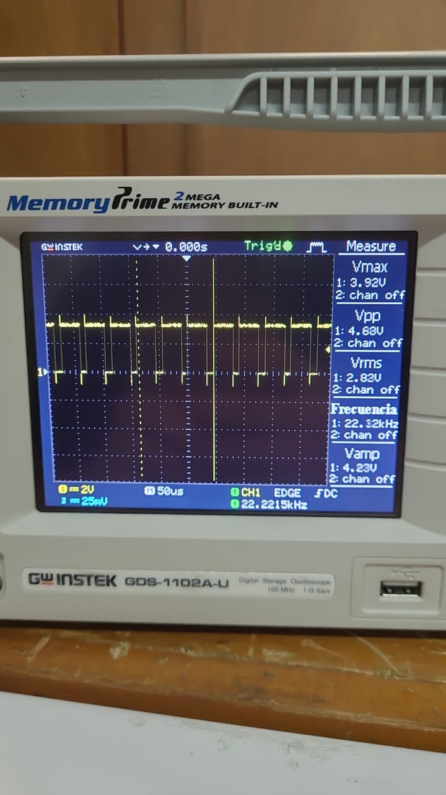 | 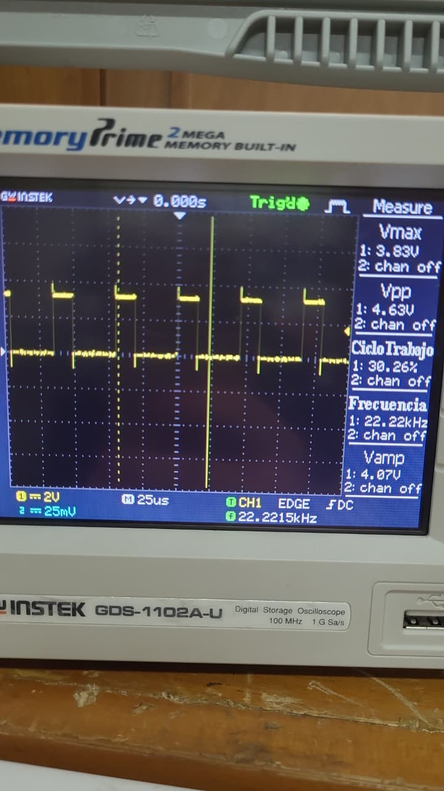 |

En la primera captura se observa una frecuencia de aproximadamente **22,32 kHz**. La segunda muestra **22,22 kHz** y un duty de nivel alto de **30,26 %**, consistente con un mando cercano al **70 %** tras la inversión. La primera fotografía no incluye una medición automática de duty en pantalla. Los mandos del 25 % y 70 % corresponden a pruebas individuales del PWM; el valor fijo de arranque del firmware actual es 15 %.

#### Resistencias al 70 % y al 10 %

| Resistencias al 70 % | Resistencias al 10 % |
|---|---|
| 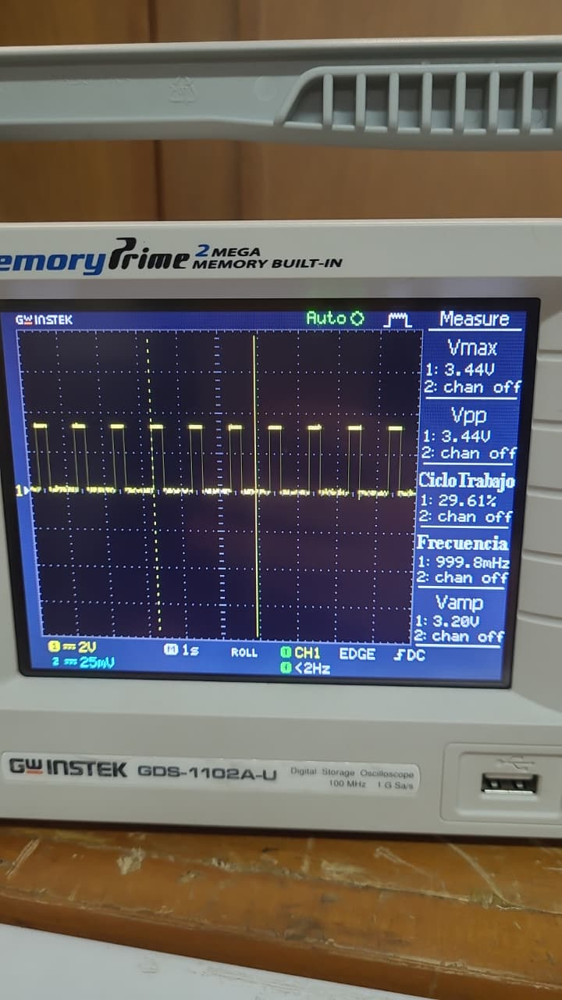 | 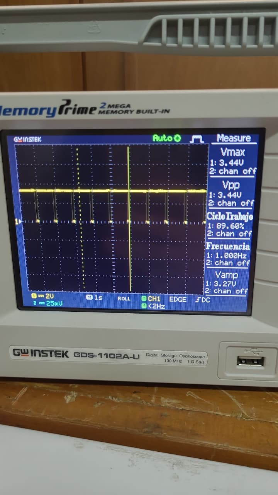 |

Con las resistencias al **70 %**, el osciloscopio indica **999,8 mHz**, aproximadamente **1 Hz**, y un duty de nivel alto de **29,61 %**. Para el mando de **10 %**, indica **1,000 Hz** y **89,60 %** de nivel alto. Al considerar la inversión, los porcentajes equivalentes son aproximadamente **70,39 %** y **10,40 %**, respectivamente. Ambas capturas son coherentes con el período de **1 s** configurado para la calefacción.

---

## 6. Estructura del Repositorio

La estructura actual del proyecto reúne el firmware, la webapp, las pruebas y la documentación de hardware:

```text
├── src/                   # Fuentes C y cabeceras del firmware LPC1769
├── webapp/                # Interfaz web, comunicación serie, servidor local y pruebas JS
├── tests/                 # Pruebas del firmware en C y scripts de validación en Python
├── hardware/
│   └── diagramas/         # Diagramas originales en PDF y vistas PNG para el README
├── docs/
│   └── ensayos/           # Fotografías de las señales PWM medidas con osciloscopio
├── .settings/             # Configuración del proyecto en MCUXpresso
├── Debug/                 # Archivos generados de compilación y validación, excluidos de Git
├── .cproject              # Configuración de compilación y enlace de MCUXpresso
├── .project               # Definición del proyecto y referencia a la biblioteca CMSIS
├── Sistema-de-Control-Termico-para-Incubadora-Neonatal-a-Escala LinkServer Debug.launch
│                          # Configuración de depuración con LinkServer
├── .gitignore             # Exclusiones de Git para archivos generados y temporales
└── README.md              # Descripción, arquitectura y ensayos del proyecto
```

El firmware utiliza la biblioteca `CMSISv2p00_LPC17xx`, ubicada en un proyecto hermano dentro del workspace de MCUXpresso. La carpeta `src/` contiene tanto las implementaciones como sus cabeceras.

Las carpetas de compilación `Debug/` y `Release/`, junto con los archivos compilados y temporales, están excluidas mediante `.gitignore`. `Release/` se generará al utilizar esa configuración de compilación.
